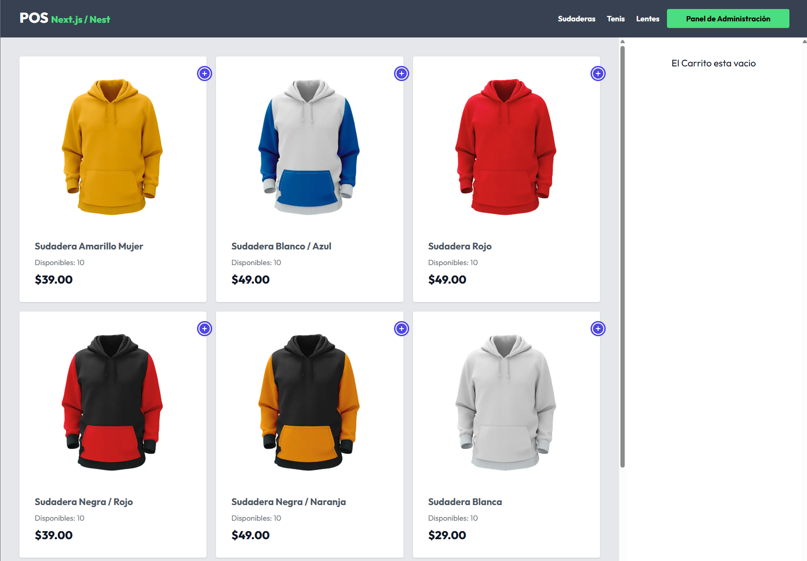

# 🛒 POS – Frontend (Next.js)

Interfaz web de un **Punto de Venta (POS)** para una tienda de ropa y accesorios. Incluye una tienda donde se arman las ventas con un carrito y cupones de descuento, y un panel de administración para gestionar productos y consultar las ventas por fecha.

Está construida con **Next.js 15** (App Router), **React 19**, **TypeScript** y **Tailwind CSS**, y consume la API del backend hecho con NestJS.

> 🔗 El backend de este proyecto está en [pos-backend](https://github.com/SuemyDzib/pos-backend).



## ✨ Características

### Tienda

- **Productos por categoría**, con navegación generada a partir de las categorías de la API.
- **Indicador de disponibilidad**: los productos sin inventario se muestran como *Agotado* y no se pueden agregar.
- **Carrito de venta** para agregar productos, cambiar cantidades (limitadas al inventario disponible) y eliminarlos.
- **Cupones de descuento**: se validan contra la API y el descuento se refleja en el total.
- **Confirmación de compra** que registra la venta y actualiza el inventario mostrado.

### Panel de administración

- **Listado de productos paginado** con imagen, precio e inventario.
- **Crear, editar y eliminar productos**.
- **Subida de imágenes arrastrando y soltando** (JPG o PNG), almacenadas en Cloudinary a través del backend.
- **Reporte de ventas por fecha** con un calendario, el detalle de cada venta, cupones usados y el total del día.

## 🛠️ Tecnologías

- [Next.js 15](https://nextjs.org/) con App Router, Server Components y Server Actions
- [React 19](https://react.dev/) y [TypeScript](https://www.typescriptlang.org/)
- [Tailwind CSS](https://tailwindcss.com/)
- [Zustand](https://zustand-demo.pmnd.rs/) para el estado del carrito
- [TanStack Query](https://tanstack.com/query) para el reporte de ventas
- [Zod](https://zod.dev/) para validar formularios y respuestas de la API
- [React Dropzone](https://react-dropzone.js.org/) para la subida de imágenes
- [React Calendar](https://github.com/wojtekmaj/react-calendar) y [date-fns](https://date-fns.org/)
- [React Toastify](https://fkhadra.github.io/react-toastify/) para notificaciones

## 📋 Requisitos

- [Node.js](https://nodejs.org/) 18.18 o superior
- El [backend del POS](https://github.com/SuemyDzib/pos-backend) corriendo localmente o desplegado

## 🚀 Instalación y uso

1. Clona el repositorio:

   ```bash
   git clone https://github.com/SuemyDzib/pos-frontend.git
   cd pos-frontend
   ```

2. Instala las dependencias:

   ```bash
   npm install
   ```

3. Crea un archivo `.env` a partir del ejemplo:

   ```bash
   cp .env.example .env
   ```

   ```env
   API_URL=http://localhost:3000
   NEXT_PUBLIC_API_URL=http://localhost:3000
   NEXT_PUBLIC_DOMAIN=http://localhost:3001
   ```

4. Inicia el servidor de desarrollo:

   ```bash
   npm run dev
   ```

5. Abre `http://localhost:3000` en tu navegador.

### Variables de entorno

| Variable              | Descripción                                                                 |
| --------------------- | --------------------------------------------------------------------------- |
| `API_URL`             | URL del backend, usada desde el servidor (Server Components y Server Actions) |
| `NEXT_PUBLIC_API_URL` | URL del backend, usada desde el navegador para mostrar imágenes            |
| `NEXT_PUBLIC_DOMAIN`  | URL de este frontend, usada para consultar las rutas internas de la API     |

### Scripts

| Comando         | Descripción                                    |
| --------------- | ---------------------------------------------- |
| `npm run dev`   | Inicia el servidor de desarrollo               |
| `npm run build` | Genera la versión de producción                |
| `npm start`     | Ejecuta la versión de producción               |
| `npm run lint`  | Analiza el código con ESLint                   |

## ☁️ Despliegue

Si despliegas el backend en otro dominio, agrégalo a `images.remotePatterns` en `next.config.ts` para que Next.js pueda mostrar las imágenes de los productos, y actualiza las variables de entorno con las URLs de producción.

## 📝 Notas

El panel de administración no tiene autenticación, así que cualquier persona con acceso a la app puede entrar a `/admin`. Es un proyecto de práctica; para producción convendría agregar inicio de sesión.

## 👤 Autor

Desarrollado por **Suemy Dzib** – [@SuemyDzib](https://github.com/SuemyDzib) a través del curso de Udemy impartido por Juan de la Torre.